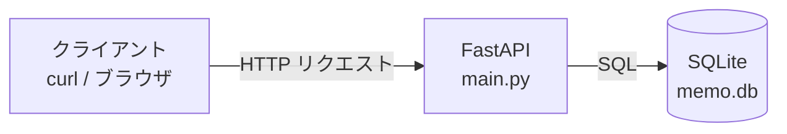
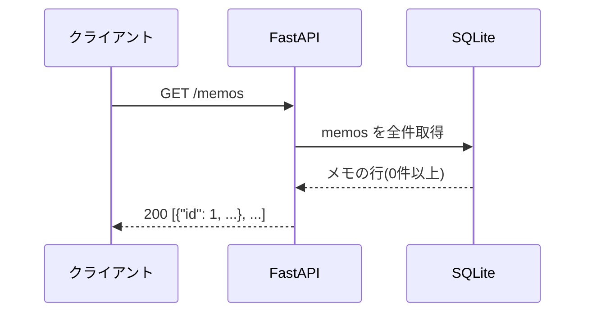
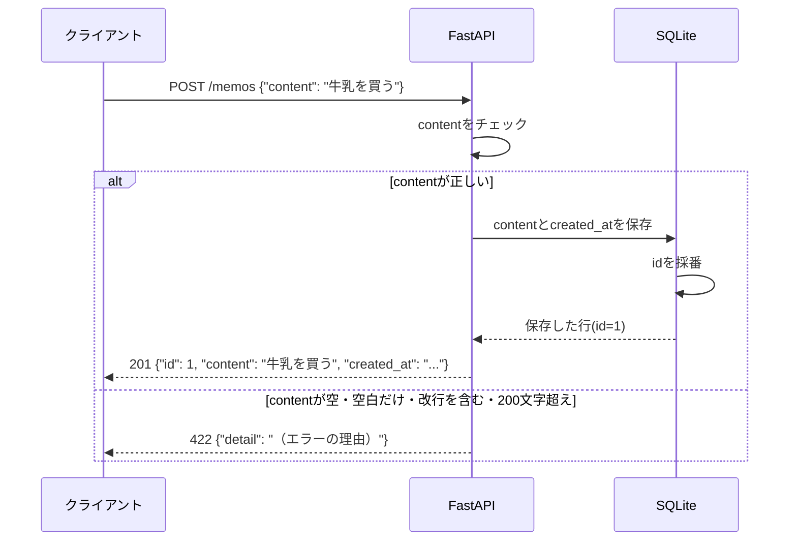
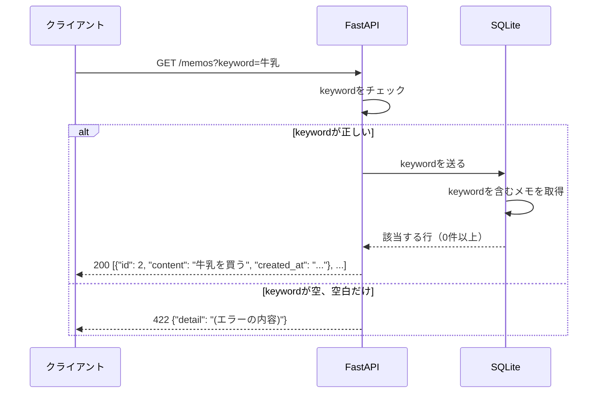
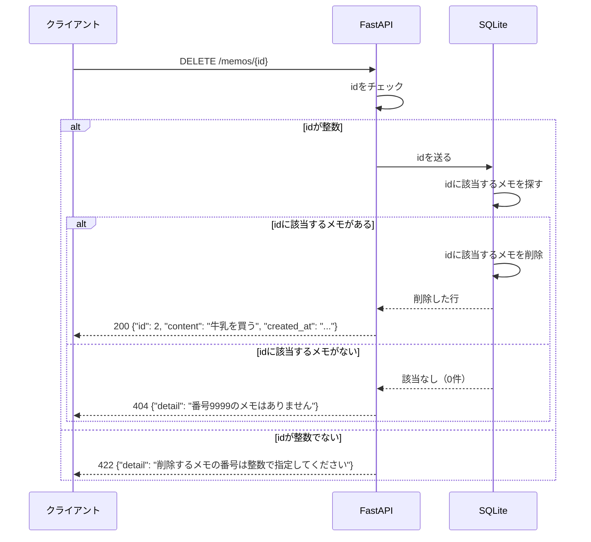

# memo-app 設計図

## 構成図

## シーケンス図
### 一覧(GET /memos)

### 追加(POST /memos)

### 検索（GET /memos?keyword=牛乳）

### 削除（DELETE /memos/{id}）

## エラー処理の方針
- 入力チェックはクライアントからFastAPIへリクエストが送られたタイミングでFastAPI内で行っている。
- エラーの時、DBは変更されない。
- ステータスコードを決めるのはFastAPI
- 404だけはFastAPIだけでは判断できない。メモがあるかどうかはDBに聞いて初めてわかるので、DBの結果（該当なし）を見て、FastAPIが404を返す
